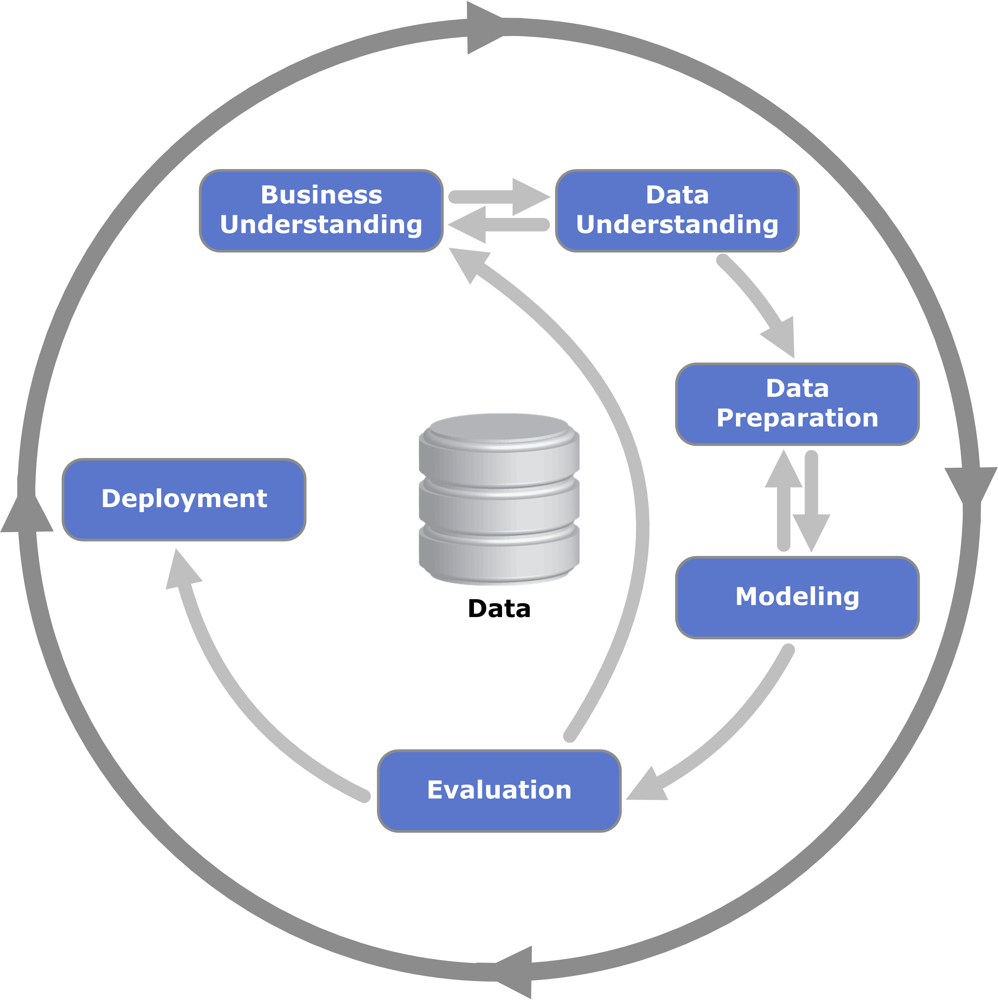

# Reto de "Inteligencia artificial avanzada para la ciencia de datos"

Este proyecto usa la metodología CRISP-DM.



<sub>Diagrama: Kenneth Jensen, [CC BY-SA 3.0](https://creativecommons.org/licenses/by-sa/3.0/), vía [Wikimedia Commons](https://commons.wikimedia.org/wiki/File:CRISP-DM_Process_Diagram.png).</sub>

Plan del proyecto: [PVG](https://aipordefinir.github.io/ai-model-tutsipink/)

## CRISP-DM

### 1. Business Understanding

- [Business Understanding](reports/business-understanding/Business%20Understanding.pdf)

### 2. Data Understanding

Pendiente.

### 3. Data Preparation

Pendiente.

### 4. Modeling

Pendiente.

### 5. Evaluation

Pendiente.

### 6. Deployment

Pendiente.

## Archivo

Versiones entregadas antes de las correcciones:

- [Business Understanding, 7 de octubre](reports/business-understanding/archivo/entrega-2026-10-07)

## Cómo correr los notebooks

Los notebooks están en `src/notebooks/` y se corren en VS Code.

### 1. Requisitos

- Python 3.13
- VS Code con las extensiones **Python** y **Jupyter** (de Microsoft)

### 2. Entorno

Desde la raíz del repositorio:

```bash
python3.13 -m venv .venv
source .venv/bin/activate
pip install -r requirements.txt
```

En VS Code, abre el notebook y en **Select Kernel -> Python Environments** elige `.venv`.

### 3. Datos

Descarga los datos del bucket de S3 del equipo con el nombre `originales/` y colócalos en la carpeta `data/` de la raíz del repositorio. Esa carpeta está en `.gitignore`, así que no se sube.

Cada notebook lee los datos desde la ruta que indica la variable `RAIZ`, en su primera celda de código (por defecto `../../data/`). La carpeta debe tener esta estructura:

```
data/
├── fotosextraidas/        fotos de las vacas, una carpeta por vaca
├── etiquetas_bsc.xlsx     bitácora de BCS de los expertos
└── csv/
    ├── vms-3.csv          dataset de condición corporal de VMS 3
    └── <carpeta>/<id>.csv datos de ordeño, un CSV por vaca
```

### 4. Notebooks

| notebook | fase | qué hace |
|---|---|---|
| `01_ordenos.ipynb` | Data Understanding | PENDIENTE |
| `02_bcs_fotos.ipynb` | Data Understanding | describe, explora y revisa la calidad de las fotos, la bitácora de BCS y `vms-3.csv` |

Para correrlo completo presiona **Run All**. Las gráficas se guardan en `src/notebooks/figuras/`.

## Contributors

- A01066843 Facundo Bautista Barbera ([@Facundo-Barbera](https://github.com/Facundo-Barbera))
- A01199004 Oswaldo Isaías Hernández Santes ([@taqueritospro](https://github.com/taqueritospro))
- A01711368 Alfredo Alejandro Soto Herrera ([@AlejandroSH1](https://github.com/AlejandroSH1))
- A01712408 Emiliano Camacho Ponce ([@Emiliano1410](https://github.com/Emiliano1410))
- A01352358 Iker Mejía Hernández ([@ikerMJHDZ09](https://github.com/ikerMJHDZ09))
- A01711783 Jorge Manuel Oyoqui Aguilera ([@JorgeManuelOyoqui](https://github.com/JorgeManuelOyoqui))
